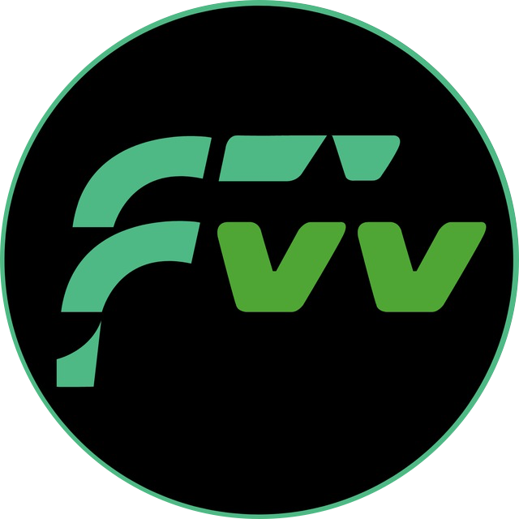

# Fractionalised World (FRW) Whitepaper

**Version 1.4 · September 2026**

Updated from the [official whitepaper](https://fractionalised.world/FRW-Whitepaper.pdf) on 6 November 2026. The Markdown sections reproduce the PDF text with formatting adapted for GitHub; the [included PDF](assets/FRW-Whitepaper.pdf) is the authoritative source.

## Abstract (preview)

Fractionalised World is a next-generation DeFi ecosystem that connects digital participation with real-world products, services, experiences and commercial activity through its proprietary Digital Fusions mechanism.

Unlike traditional DeFi protocols that rely primarily on speculative token dynamics, Fractionalised World is designed to create a digital participation ecosystem with functional connections to real-world products, services, experiences and commercial activity through Digital Fusions. These connections are designed around ecosystem utility and participation and do not confer ownership, equity, revenue, profit or asset rights in underlying businesses or commercial activities.

Participants purchase Access NFTs and Themed NFTs to engage with the ecosystem which may enable interaction with the protocol's structured token distribution mechanics and eligibility for community engagement events.

The Access NFT serves as the essential entry point to the platform, enabling interaction with the protocol's token distribution framework, staking participation tiers and community engagement initiatives.

Themed NFTs enhance this experience by applying protocol allocation multipliers of up to 6x to a participant's combined emission base and enabling additional ecosystem participation functionality, creating a gamified and engaging ecosystem.

## Read online (GitHub navigation)

- Start here: [Executive Summary](03-executive-summary.md)
- Legal: [IMPORTANT NOTICE AND DISCLAIMER](01-important-notice-and-disclaimer.md) · [RISK FACTORS](02-risk-factors.md) · [LEGAL NOTICE AND CLOSING DISCLAIMER](07-legal-notice-and-closing-disclaimer.md)
- Core sections: [1. Fractionalised World](04-1-fractionalised-world.md) · [2. NFTs](05-2-nfts.md) · [3. FRW Token](06-3-frw-token.md)
- Reference: [Glossary](08-glossary.md)
- PDF: [FRW-Whitepaper.pdf](assets/FRW-Whitepaper.pdf)

## Full contents

- [IMPORTANT NOTICE AND DISCLAIMER](01-important-notice-and-disclaimer.md)
- [RISK FACTORS](02-risk-factors.md)
- [Executive Summary](03-executive-summary.md)
- [1. Fractionalised World](04-1-fractionalised-world.md)
- [2. NFTs](05-2-nfts.md)
- [3. FRW Token](06-3-frw-token.md)
- [LEGAL NOTICE AND CLOSING DISCLAIMER](07-legal-notice-and-closing-disclaimer.md)
- [Glossary](08-glossary.md)
